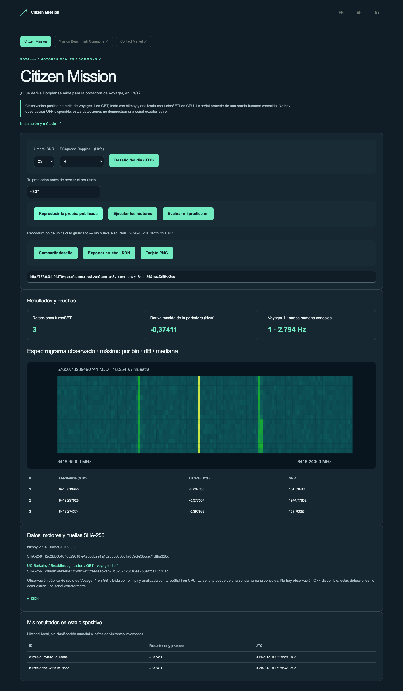

# Citizen Mission

## Demo pública sin instalación

[Abrir la demo ES](https://gbesse.github.io/citizen-mission/es/space/commons/citizen/?lang=es) · [FR](https://gbesse.github.io/citizen-mission/fr/space/commons/citizen/?lang=fr) · [EN](https://gbesse.github.io/citizen-mission/en/space/commons/citizen/?lang=en).

La edición pública reproduce pruebas de cálculo archivadas y conserva retos diarios, ajustes compartibles y exportaciones JSON/PNG. No ejecuta motores ni expone API locales. El reto procede de un catálogo fijo; no se presupone clasificación mundial ni audiencia externa. GitHub Pages se reconstruye y prueba con cada cambio de `main`.

Para alojar bajo una ruta, usar `SITE_BASE_PATH=/citizen-mission/ npm run build`. Sin esta variable el sitio sigue funcionando en la raíz de un dominio. Los tres idiomas, enlaces, recursos y pruebas permanecen bajo el mismo prefijo. `manifest.json` registra `basePath`.

[](https://github.com/gbesse/citizen-mission/actions) · [](LICENSE) · FR / EN / ES

[Français](README.md) · [English](README.en.md) · Español

Recuperar Voyager en una observación de radio real.

Leer la observación pública Voyager 1/GBT con blimpy, buscar su deriva Doppler con turboSETI en CPU y explorar espectrograma, portadora y procedencia.



## Probar en un minuto

La demo usa cálculos reales archivados e incluidos en este repositorio autónomo. Node.js 22+ basta; no se necesita cuenta, clave API, repositorio padre ni servicio externo para reproducir.

```sh
git clone https://github.com/gbesse/citizen-mission.git
cd citizen-mission
node bin/cli.js demo --locale=es
npm start
```

http://127.0.0.1:4325/?lang=es

Interfaz local FR/EN/ES, desafío diario UTC de un catálogo fijo, predicción evaluada, URL reproducible de parámetros, prueba JSON y tarjeta PNG. Historial local; sin clasificación global ni tráfico inventado.

## Ejecutar motores reales

Python 3.11–3.13 y curl. No se requiere GPU, Java ni ION.

blimpy 2.1.4 · turboSETI 2.3.2 · CPU

```sh
npm run setup:engines
npm run test:engines
node bin/cli.js run --locale=es
```

El botón «Ejecutar» y el comando `run` inician motores instalados; «Reproducir» no inicia ningún motor. Sin sustitución sintética. La instalación descarga solo dependencias del proyecto en `.local/space-runtime`, ignorado por Git. `SPACE_RUNTIME` puede indicar un runtime existente; `SPACE_LOCALE` selecciona idioma de instalación.

## Método, datos y límites

Observación pública de radio de Voyager 1 en GBT, leída con blimpy y analizada con turboSETI en CPU. La señal procede de una sonda humana conocida. No hay observación OFF disponible: estas detecciones no demuestran una señal extraterrestre.

Se incluyen versiones, parámetros, huellas y avisos. No se redistribuyen archivos H5/SPK ni binarios; sus fuentes y SHA-256 están fijados. Dependencias y datos externos mantienen sus condiciones.

Proyecto de software independiente MIT, sin afiliación con NASA/JPL, ESA ni proveedores citados. No necesita software ni API de máquinas de fabricación. Código extraído de Frontier Lab y adaptado a repositorio autónomo; procedencia en `upstream.json`. No se traducen datos del usuario. Las exportaciones CLI no sobrescriben archivos.

## Verificar y contribuir

```sh
npm ci
npm test
npx playwright install chromium
npm run test:browser
npm run format:check
```

`npm run build` exporta `output/site` para alojamiento estático en la raíz de un dominio. Esta edición reproduce casos publicados, sin exponer motores ni API locales.

[Mission Benchmark Commons](https://github.com/gbesse/mission-benchmark-commons) · [Contact Market](https://github.com/gbesse/contact-market) · [Citizen Mission](https://github.com/gbesse/citizen-mission)

## Recálculo independiente de deriva

`fitPeakDrift(peakTrack)` ajusta una recta centrada a frecuencias exportadas (MHz) y tiempos (segundos), devuelve pendiente en Hz/s, RMSE en Hz, duración, puntos y R² (indefinido con frecuencia constante). Repeticiones y cálculos nuevos muestran `driftAudit` y exigen concordancia de 0,00001 Hz/s con la pendiente registrada. Recalcula el pico exportado, no señal original: no demuestra calibración, incertidumbre física, ausencia de interferencias, identificación extraterrestre ni observación OFF.

El ajuste de deriva elimina un origen común de tiempo y frecuencia antes de promediar para no perder diferencias pequeñas representables al sumar fechas grandes. Una prueba sintética de traslación verifica pendiente y residuos; se siguen comprobando fixtures Voyager. No añade resolución a valores ya redondeados ni convierte el ajuste en identificación independiente de fuente.
